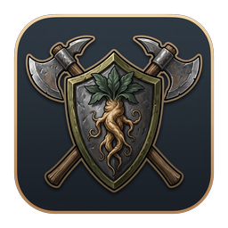

<p align="center">
  
</p>

# Mandrake

A modern, cross-platform Rust source port for Bungie's ***Myth II: Soulblighter*** and ***Myth: The Fallen Lords***.

Mandrake reads your original game files and runs a deterministic simulation that replays original 1.8.5 films tick-for-tick and interoperates with 1.8.5 multiplayer peers — rendered with `wgpu` (Vulkan, DirectX 12, Metal) and Modern-Retro visual enhancements out of the box.

**[Download the latest release](https://github.com/bbeazley/mandrake/releases/latest)** — prebuilt portable archives for **Windows (x86_64 & ARM64)**, **macOS (Apple Silicon)**, and **Linux (x86_64 & ARM64 / Steam Deck)**.

> **Game data is not included.** You need your own legal copy of **Myth II: Soulblighter patched to 1.8.5** (and **Myth: The Fallen Lords 1.5** if you want to play TFL). You can update an existing Myth II or TFL installation using the official patches from [Project Magma](https://projectmagma.net/).

---

## Quick Start

1. **Download** the archive for your OS from the [Releases page](https://github.com/bbeazley/mandrake/releases/latest).
2. **Extract** the archive directly into your `Myth II` folder (the folder containing `tags/`, `plugins/`, `recordings/`, etc.).
3. **Run Mandrake:**
   - **Windows:** double-click `mandrake.exe`
   - **macOS:** double-click `Mandrake.app`
   - **Linux / Steam Deck:** run `./mandrake.sh` (or `./mandrake`)

If you extract Mandrake into a separate folder instead, it will open a folder picker on first launch so you can point it at your `Myth II` folder — the path is saved automatically to `mandrake.toml`.

### First-Launch Security Prompts (Unsigned Builds)

Prebuilt releases are currently unsigned, so your OS may show a one-time warning on first launch:

- **Windows (SmartScreen):** Click **More info** → **Run anyway**.
- **macOS (Gatekeeper):** Right-click `Mandrake.app` → **Open** (or open *System Settings → Privacy & Security → Open Anyway*). Alternatively, remove the quarantine attribute in Terminal:
  ```bash
  xattr -dr com.apple.quarantine Mandrake.app
  ```

---

## Portable Configuration & Visual Presets

Mandrake is **fully portable**: its settings file (`mandrake.toml`) and caches (`cache/`) live right next to the executable (next to `Mandrake.app` on macOS).

- **Modern-Retro (default):** On first run, Mandrake automatically creates `mandrake.toml` beside the executable using the Modern-Retro preset (sharp sprites, Lanczos-2 UI scaling, lighting, height fog, and TFL smoothing). Edit `mandrake.toml` in any text editor to customize settings.
- **Original Look:** For the classic 1.8.5 / TFL 1.5 renderer look, launch with:
  ```
  --conf mandrake.original.toml
  ```

---

## Playing *Myth: The Fallen Lords* (TFL 1.5)

Mandrake plays *Myth: The Fallen Lords* from the same executable using the `--game tfl` launch flag:

- **Windows:** Right-click `mandrake.exe` → **Create shortcut** → right-click the shortcut → **Properties** → append `--game tfl` to the **Target** field (e.g. `"C:\Games\Myth II\mandrake.exe" --game tfl`).
- **macOS:** Launch from Terminal or a tiny Automator/Shortcuts app:
  ```bash
  open -a /path/to/Mandrake.app --args --game tfl
  ```
- **Linux / Steam Deck:** Run `./mandrake.sh --game tfl`, or add `--game tfl` to the Steam shortcut's **Launch Options**.

If TFL isn't found automatically, Mandrake prompts you to pick your `Myth_TFL` folder (containing `tags/*.gor`) and saves it to `[game] tfl_data` in `mandrake.toml`.

> **TFL Sprite Interpolation:** On first TFL launch, Mandrake automatically downloads the MIT-licensed RIFE v4.6 weights (~10 MB, SHA-256 verified) into `cache/` and builds smooth in-between locomotion frames with a progress bar on the TFL loading screen. Subsequent launches are instant. If you are offline, Mandrake falls back cleanly to TFL's original frames.

---

## Steam Deck (Gaming Mode)

1. In Desktop Mode, extract the Linux x86_64 archive into your Myth II folder (or to `~/Games/mandrake` with your Myth II data in `~/Games/mandrake/data`).
2. In Steam (Desktop Mode): **Games → Add a Non-Steam Game to My Library → Browse** and select `mandrake.sh` (set the file filter to *All Files*).
3. Open **Properties → Compatibility** and leave no compatibility tool forced (or choose *Steam Linux Runtime*). **Do not use Proton** — Mandrake is a native Linux binary and will crash under Proton.
4. *(Optional)* Add launch options such as `--game tfl` or `--conf mandrake.original.toml`.
5. Switch back to Gaming Mode and select a mouse-and-keyboard Steam Input layout (e.g. *Keyboard (WASD) and Mouse* with trackpad as mouse).

---

## Troubleshooting & FAQ

- **GPU Requirements:** Mandrake requires a GPU supporting **DirectX 12 / Vulkan** (Windows), **Metal** (macOS), or **Vulkan** (Linux / Steam Deck). Update your GPU drivers if the window fails to open.
- **Where are saves and recordings stored?** In `saved games/` and `recordings/` inside your Myth II folder, compatible with the original game. Mandrake does not overwrite the original game's preference files.
- **How do I see debug logs?** Launch Mandrake from a terminal with `RUST_LOG=info` (stderr carries logs; stdout prints the carnage report when a map ends).
- **Antivirus false positives:** Unsigned Rust binaries occasionally trigger Windows Defender heuristics; you can verify any download against `SHA256SUMS.txt` on the Releases page or build from source below.

---

## Building from Source

Mandrake is written in **Rust (stable, edition 2024)**.

### Prerequisites

- **All platforms:** [Rust stable toolchain](https://rustup.rs/) (`rustup`)
- **Windows:** Visual Studio Build Tools with the *Desktop development with C++* workload
- **macOS:** Xcode Command Line Tools (`xcode-select --install`)
- **Linux:** `libasound2-dev` (ALSA), `pkg-config`, `cmake`, and `nasm` (on x86_64 for AV1 cutscene assembly), plus Wayland/X11 and Vulkan runtime libraries
- **Nix (optional):** `nix develop` using the included `flake.nix` provides the complete toolchain (including `wasm32-unknown-unknown`, `wasm-bindgen-cli`, `binaryen`, and `nasm`)

### Compile

```bash
# Native client (outputs target/release/mandrake)
cargo build --release --locked -p mandrake-client --bin mandrake

# Dedicated server & WebSocket proxy (self-hosted multiplayer)
cargo build --release --locked -p mandrake-server --bin mandrake-server --bin mandrake-ws-proxy

# Data inspection tools (tag archives & recordings)
cargo build --release --locked -p m2-tag-dump -p m2-rec-dump

# Run self-contained unit tests (no game data required)
cargo test --workspace --locked
```

### Command-Line Options

Run `mandrake --help` for the full list. Common flags:

| Option | Effect |
|---|---|
| `--archive PATH` | Path to `tags/small install` (overrides auto-detection) |
| `--game tfl` | Launch *Myth: The Fallen Lords* |
| `--tfl-data DIR` | Path to your `Myth_TFL` folder |
| `--conf FILE` | Use an alternate config file (e.g. `mandrake.original.toml`) |
| `--write-default-conf FILE` | Write all shipped settings with comments, then exit |
| `--play MESH --difficulty 0..4` | Jump straight into a solo level (e.g. `cr01`) |
| `--replay NAME` | Replay a film from `recordings/` |
| `--net-host PORT` / `--net-join HOST:PORT` | Host or join a TCP/IP game (default port `3453`) |
| `--width W --height H` | Window size when not fullscreen |
| `--headless --screenshot out.png --ticks N` | Render a frame headless |

---

## Self-Hosting: Dedicated Server & Web Client

The dedicated server (`mandrake-server`), WebSocket proxy (`mandrake-ws-proxy`), and WebGPU browser client (`mandrake-web`) are designed for self-hosting via Docker or from source.

### Docker (Server + Web Client)

```bash
mkdir -p docker/config docker/films docker/logs
docker/build.sh                                      # or: docker compose -f docker/compose.yaml build
MYTH2_DATA="/path/to/Myth II" docker compose -f docker/compose.yaml up -d
curl -s http://127.0.0.1:8080/healthz                # ok
```

- **Port `3453/tcp`** accepts native Mandrake and original 1.8.5 clients.
- **Port `8080`** (bound to `127.0.0.1` by default) serves the WebGPU web client and `/myth2-ws` WebSocket proxy; place behind HTTPS for remote players.
- Set **`M2_SITE_DATA=1`** only with data you are permitted to distribute (such as the Myth II demo).

### Building the Web Client Manually

```bash
rustup target add wasm32-unknown-unknown
cargo build --release --locked --target wasm32-unknown-unknown -p mandrake-web --lib
wasm-bindgen --target web --out-dir web/pkg target/wasm32-unknown-unknown/release/mandrake_web.wasm
mkdir -p web/js && cp crates/mandrake-web/js/*.js web/js/
cp scripts/web/client.html web/index.html && cp scripts/web/client.js web/
```

See [docs/server.md](docs/server.md) and [docs/web.md](docs/web.md) for full self-hosting details.

---

## Architecture & Documentation

- [docs/SPEC.md](docs/SPEC.md) — full architecture, crate map, tick/frame model, and subsystem specs
- [AGENTS.md](AGENTS.md) — contributor and coding-agent guide

---

## Licence

Mandrake's source code is dual-licensed under either of:

- **MIT License** ([LICENSE-MIT](LICENSE-MIT))
- **Apache License, Version 2.0** ([LICENSE-APACHE](LICENSE-APACHE))

at your option. Third-party crate and model notices are in [THIRD_PARTY_NOTICES.md](THIRD_PARTY_NOTICES.md).

*Myth II: Soulblighter* and *Myth: The Fallen Lords* game data (tags, maps, sounds, artwork) remain the property of their respective owners and are not included in this repository.
